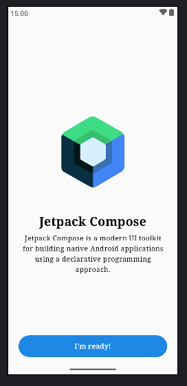
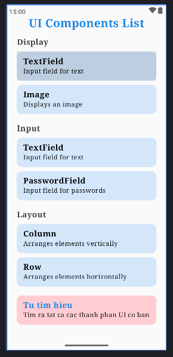
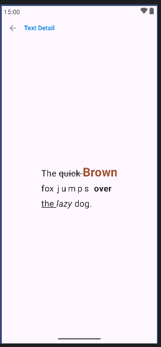
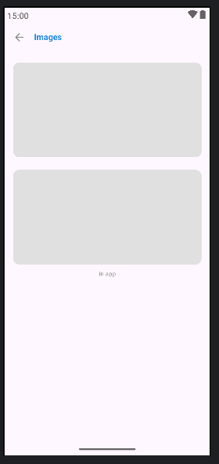
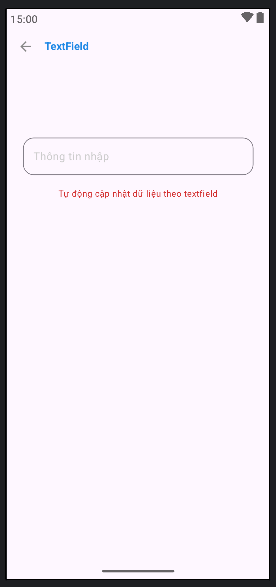
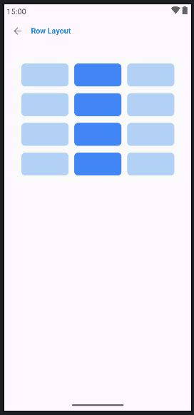

# BÁO CÁO BÀI TẬP TUẦN 04 - BÀI 01
## XÂY DỰNG ỨNG DỤNG HIỂN THỊ CÁC THÀNH PHẦN UI CƠ BẢN VÀ ĐIỀU HƯỚNG (NAVIGATION)

---

## 1. Mô tả bài tập & Mục tiêu đạt được

### a. Mô tả ngắn gọn:
Xây dựng một ứng dụng Android hoàn chỉnh bằng **Jetpack Compose** gồm nhiều màn hình, sử dụng thư viện **Navigation Compose** để chuyển hướng giữa các màn hình. Ứng dụng phân loại và trình diễn chi tiết các thành phần giao diện cơ bản (Display, Input, Layout) và áp dụng các nguyên tắc UI/UX Best Practices (Skeleton Placeholder loading, bố cục Responsive).

### b. Mục tiêu đạt được:
- Làm chủ cơ chế điều hướng đa màn hình với `NavHost` và `NavController`.
- Nắm vững các thành phần hiển thị văn bản nâng cao (`buildAnnotatedString`), hình ảnh từ Internet/in-app (`Coil`), ô nhập liệu phản ứng thời gian thực (`OutlinedTextField`), và bố cục lưới tự co giãn (`Row` kết hợp `weight`).
- Áp dụng kỹ thuật **Skeleton** (khung xương giữ chỗ khi tải dữ liệu) đúng chuẩn thiết kế UI/UX hiện đại.

---

## 2. Giải thích ngắn gọn các hàm chính

### 1. `AppNavigation()` (File: `MainActivity.kt`)
- **Chức năng:** Quản lý toàn bộ sơ đồ chuyển trang của ứng dụng.
- **Hoạt động:** Khởi tạo `rememberNavController()` và định nghĩa `NavHost` với điểm bắt đầu là `"welcome"`. Đăng ký 6 tuyến đường (`welcome`, `components_list`, `text_detail`, `images_detail`, `textfield_detail`, `row_layout`). Sử dụng `navigate()` để mở màn hình mới và `popBackStack()` để quay lại.

### 2. `WelcomeScreen(onNavigateToList)` (File: `WelcomeScreen.kt`)
- **Chức năng:** Màn hình giới thiệu ban đầu (Splash/Welcome).
- **Hoạt động:** Bố cục dọc bằng `Column(SpaceBetween)` để đẩy logo Jetpack Compose và đoạn giới thiệu lên trên, nút bấm bo góc 24dp **"I'm ready"** xuống đáy. Khi người dùng bấm nút, kích hoạt callback `onNavigateToList` để chuyển đến menu chính.

### 3. `ComponentsListScreen(...)` (File: `ComponentsListScreen.kt`)
- **Chức năng:** Menu danh mục hiển thị các thành phần UI cơ bản.
- **Hoạt động:** Nhóm các thành phần thành 4 khu vực: **Display** (Text, Image), **Input** (TextField, PasswordField), **Layout** (Column, Row), và **Tự tìm hiểu**. Các mục được thiết kế bằng thẻ `Card` màu xanh nhạt bo góc 12dp, tích hợp sự kiện `.clickable` để chuyển đến từng màn hình chi tiết tương ứng.

### 4. `TextDetailScreen(onBack)` (File: `DetailScreens.kt`)
- **Chức năng:** Trình diễn định dạng văn bản đa dạng trên cùng một câu văn.
- **Hoạt động:** Sử dụng `buildAnnotatedString` kết hợp `SpanStyle` để tùy biến từng cụm từ trong câu *"The quick Brown fox jumps over the lazy dog."*:
  - `"quick"`: gạch ngang chữ (`TextDecoration.LineThrough`).
  - `"Brown"`: cỡ chữ 30sp, màu nâu đậm, in đậm (`FontWeight.Bold`).
  - `"j u m p s"`: dãn cách chữ (`letterSpacing = 5.sp`).
  - `"the"`: gạch chân (`TextDecoration.Underline`).
  - `"lazy"`: in nghiêng (`FontStyle.Italic`).

### 5. `ImagesDetailScreen(onBack)` (File: `DetailScreens.kt`)
- **Chức năng:** Hiển thị hình ảnh từ URL và ảnh trong ứng dụng, có tích hợp **Skeleton Loading**.
- **Hoạt động:** Sử dụng composable `SubcomposeAsyncImage` của thư viện Coil. Trong lúc ảnh đang được tải từ Internet, trạng thái `loading` kích hoạt một khối `Box` màu xám nhạt (`#E0E0E0`) bo tròn để làm khung xương giữ chỗ (Skeleton), ngăn giao diện bị giật lag khi tải xong.

### 6. `TextFieldDetailScreen(onBack)` (File: `DetailScreens.kt`)
- **Chức năng:** Minh họa ô nhập dữ liệu và cơ chế cập nhật trạng thái động (State).
- **Hoạt động:** Quản lý biến trạng thái `inputText` bằng `remember { mutableStateOf("") }`. Khi người dùng gõ vào `OutlinedTextField`, sự kiện `onValueChange` lập tức cập nhật giá trị và kích hoạt Compose vẽ lại (recomposition) dòng chữ màu đỏ bên dưới hiển thị theo nội dung vừa nhập.

### 7. `RowLayoutScreen(onBack)` (File: `DetailScreens.kt`)
- **Chức năng:** Trình diễn bố cục ngang (`Row Layout`) và mô phỏng Skeleton Layout dạng lưới.
- **Hoạt động:** Sử dụng vòng lặp `repeat(4)` tạo ra 4 hàng; mỗi hàng gồm 3 khối chữ nhật bo góc chia đều theo tỉ lệ bằng `Modifier.weight(1f)`. Khối ở giữa được phối màu xanh đậm (`#4285F4`) tạo điểm nhấn thị giác và cân đối trên mọi kích thước màn hình.

---

## 3. Kết quả đầu ra của ứng dụng (Output)

| 1. Màn hình Chào (Welcome) | 2. Menu danh sách UI Components |
| :---: | :---: |
|  |  |

| 3. Chi tiết Text (Text Detail) | 4. Chi tiết Ảnh & Skeleton (Images) |
| :---: | :---: |
|  |  |

| 5. Chi tiết Nhập liệu (TextField) | 6. Bố cục hàng (Row Layout) |
| :---: | :---: |
|  |  |